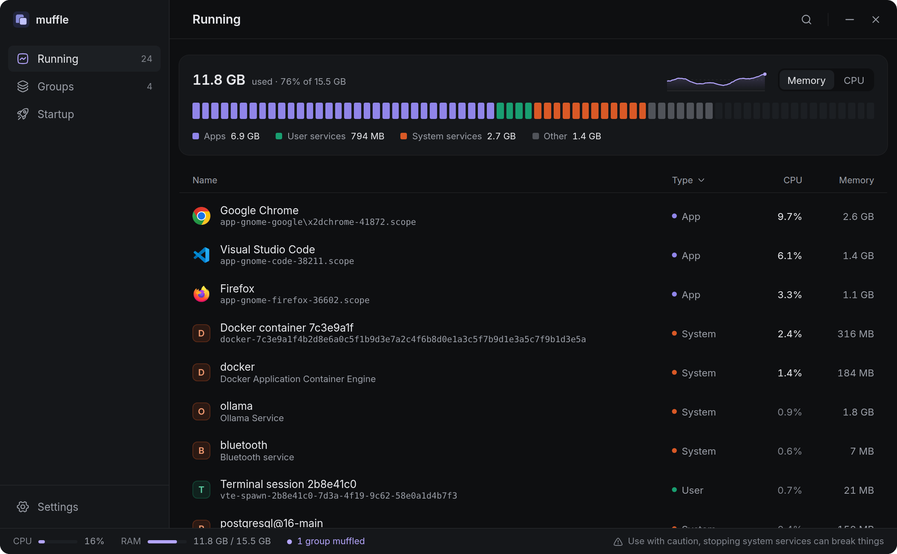
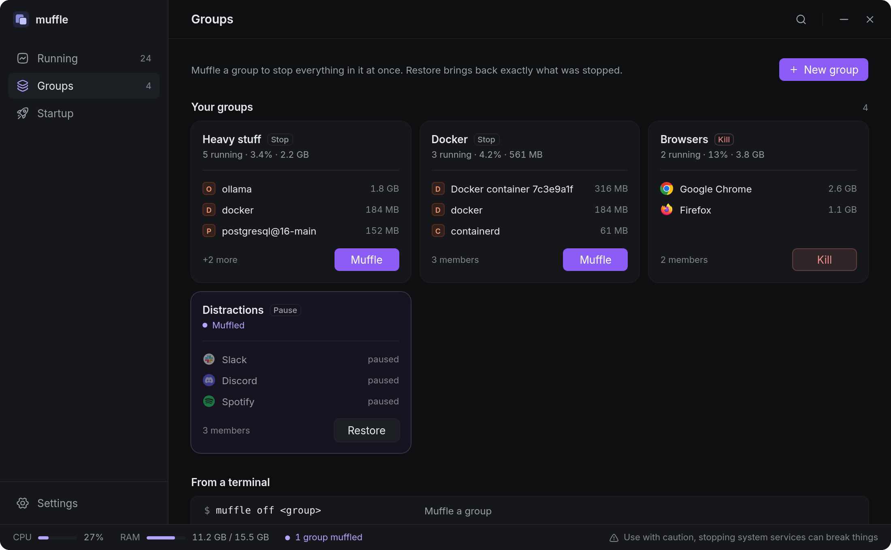
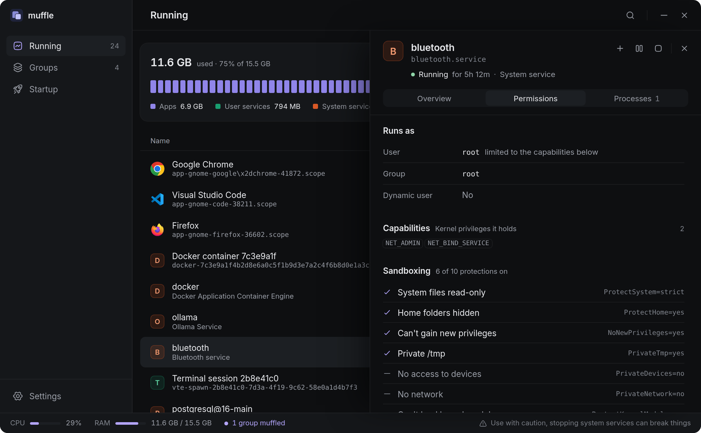
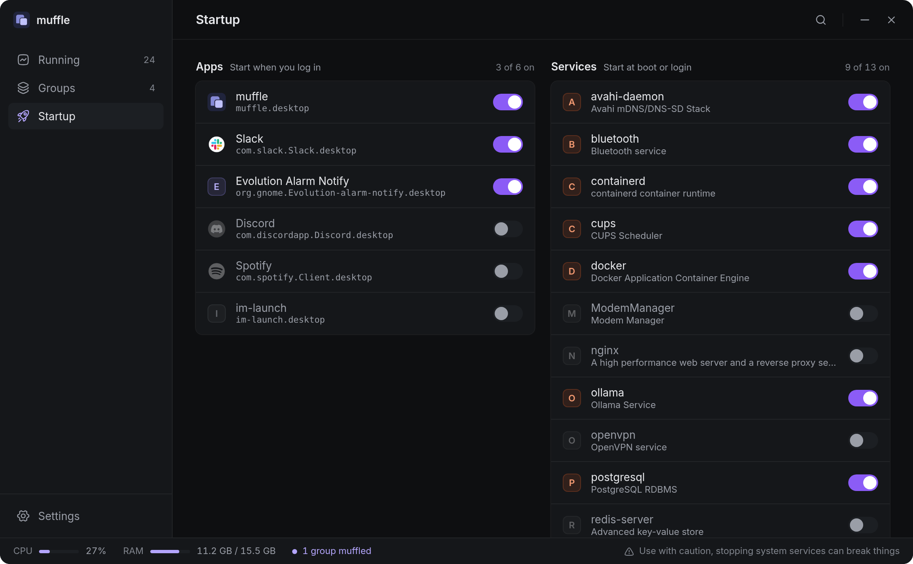
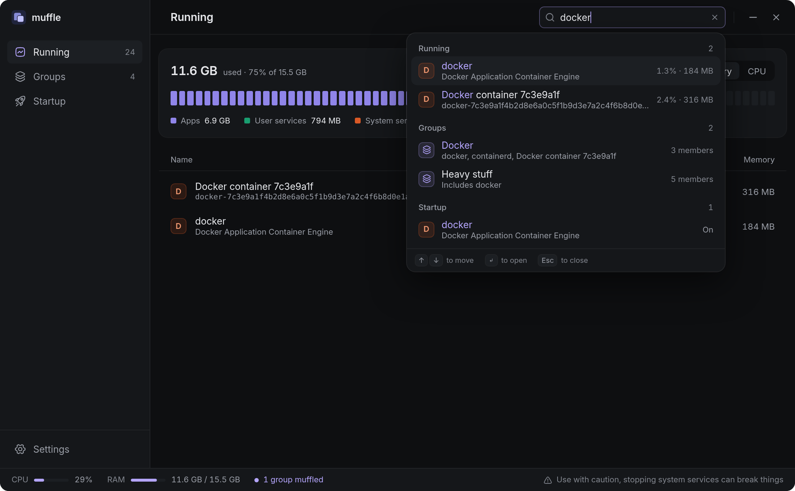

# muffle

> Muffle the background, give the build the CPU.

A small Linux desktop app that lists what's running, turns startup on and off,
and switches whole **groups** of services and apps off and back on in one
click. For example, turn "Heavy stuff" off while doing Node.js dev and back on
afterwards.

Linux only (systemd). Built with Tauri 2 and React.
Docs and screenshots: **[iput-object.github.io/muffle](https://iput-object.github.io/muffle/)**



## Features

- **Running**: every running service and app with live CPU and RAM, and a
  memory or CPU meter for the whole machine with a short history. Stop, start or
  pause any of them. Apps that run as several scopes (like Chrome) show as one.
  Core system units are protected.
- **Details**: click a row to see its overview, permissions (user, root,
  capabilities, how many of systemd's sandboxing protections are on) and process tree.
- **Groups**: put services and apps in a group, then muffle it (stop, pause or
  kill them all) and restore it later. A group blocks the *app*, not one
  process: it matches every launch, so the block survives relaunches and
  reboots, and muffle turns members off again if they come back. muffle only
  brings back what it turned off. A unit can be in several groups: it only goes
  off once every group it's in is muffled, and comes back as soon as one is restored.
- **Startup**: turn login apps and boot services on or off, disabled ones included.
- **Search**: <kbd>Ctrl</kbd>+<kbd>F</kbd> searches running units, groups and startup at once.
- **Tray**: muffle and restore groups without opening the window.
- **CLI**: the same binary works from the terminal.
- **Light**: refreshes only while the window is open; idle in the tray.

| Groups | Details |
| --- | --- |
|  |  |
| **Startup** | **Search** |
|  |  |

## Install

Download the AppImage, `.deb` or `.rpm` from the
[latest release](https://github.com/iput-object/muffle/releases/latest).
On Arch, install `muffle-bin` from the AUR.

muffle updates itself from Settings → Updates.

Muffled groups stay muffled only while muffle runs (it starts hidden in the
tray at login). System services may ask for your password through polkit.

## CLI

```
muffle                 open the app
muffle --hidden        start in the tray
muffle list            running units with CPU and RAM
muffle groups          groups and whether they're muffled
muffle status          muffled groups only
muffle off <group>     stop (or pause) the group
muffle on <group>      restore what muffle stopped
```

Example in fish: `muffle off heavy-stuff; and pnpm dev`

## Files

- `~/.config/muffle/config.toml`: groups and settings (hand-editable).
- `~/.local/state/muffle/state.json`: what muffle turned off, so it can undo it.

## Develop

```
pnpm install
pnpm tauri dev
```

Release: bump the version in `package.json`, `src-tauri/Cargo.toml` and
`src-tauri/tauri.conf.json`, then push a `v*` tag. The workflow builds,
signs and publishes the release with the updater manifest.

The docs site is plain HTML in `docs/`, served by GitHub Pages from `main` → `/docs`.

## License

GPL-3.0
